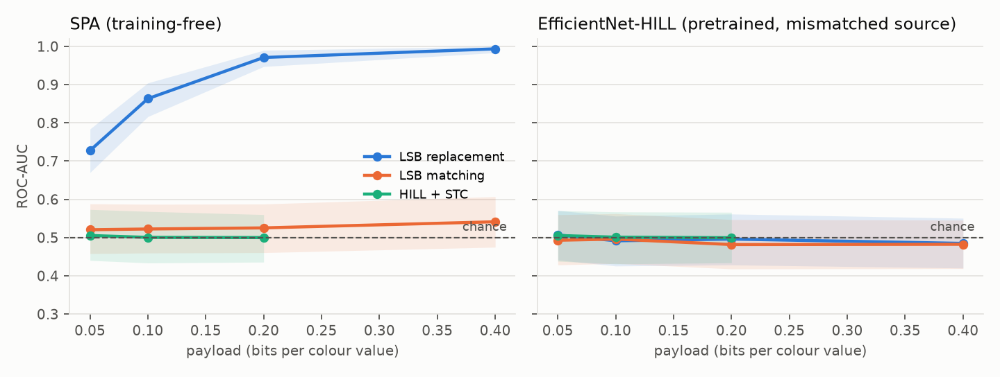
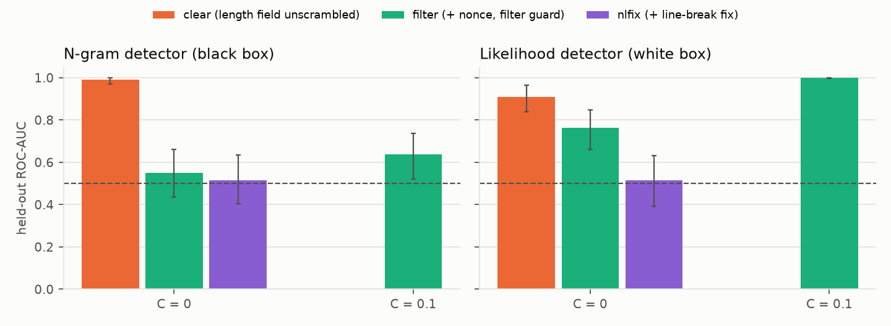
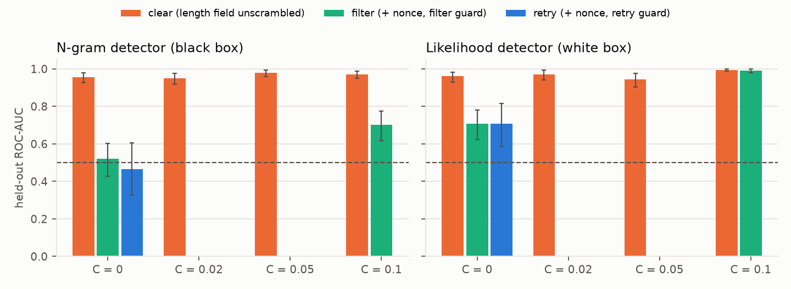
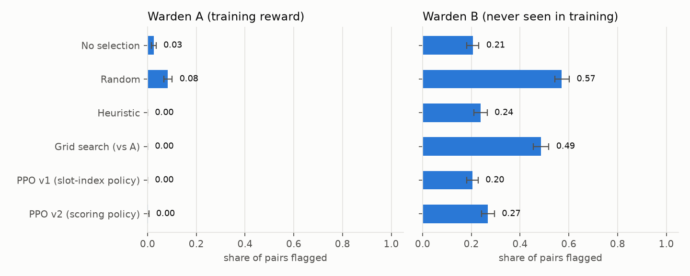
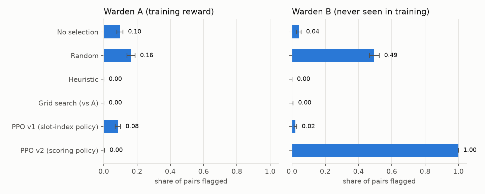

# First-stage results

Generated by `scripts/make_report.py` from the files in `results/` and `results_gpt2/`. Every number below is measured by this repository's code; nothing is quoted from papers. Sample sizes are small.

**Language models.** Text results come from two runs: **GPT-2** (124M, the model the system uses; `results_gpt2/`, run on a laptop CPU) and an earlier run with a 4-layer offline **toy model** (`data/toy-lm`; `results/`), which covers more variants and budgets. Where they overlap they agree in direction; the GPT-2 numbers are the ones to quote.

## 1. Image channel

195 cover crops (256×256 RGB): 144 from Kodak (source A), 51 from scikit-image photos (source B). 2135 stego images were embedded and decoded; 205 attempts were refused because the payload exceeded that cover's capacity (all HILL + STC on saturated or flat crops).

**Exact recovery: 2135 / 2135 (100.0%).**

| Method | Rate (bits/value) | n | PSNR (dB) | SSIM | Values changed |
| --- | --- | --- | --- | --- | --- |
| HILL + STC | 0.05 | 194 | 69.0 | 1.0000 | 0.82% |
| HILL + STC | 0.1 | 193 | 65.7 | 0.9999 | 1.78% |
| HILL + STC | 0.2 | 188 | 62.3 | 0.9998 | 3.87% |
| LSB matching | 0.05 | 195 | 64.2 | 0.9998 | 2.50% |
| LSB matching | 0.1 | 195 | 61.1 | 0.9996 | 4.99% |
| LSB matching | 0.2 | 195 | 58.1 | 0.9992 | 10.00% |
| LSB matching | 0.4 | 195 | 55.1 | 0.9984 | 20.00% |
| LSB replacement | 0.05 | 195 | 64.2 | 0.9998 | 2.50% |
| LSB replacement | 0.1 | 195 | 61.1 | 0.9996 | 5.00% |
| LSB replacement | 0.2 | 195 | 58.1 | 0.9992 | 10.00% |
| LSB replacement | 0.4 | 195 | 55.1 | 0.9984 | 19.99% |

### Detectability (ROC-AUC, clean vs stego; 0.5 = chance, 1.0 = perfect)

95% bootstrap intervals in brackets. Source A = Kodak.

| Detector | Method | 0.05 | 0.1 | 0.2 | 0.4 |
| --- | --- | --- | --- | --- | --- |
| SPA (no training) | LSB replacement | 0.73 [0.67, 0.78] | 0.86 [0.82, 0.90] | 0.97 [0.95, 0.99] | 0.99 [0.98, 1.00] |
| SPA (no training) | LSB matching | 0.52 [0.46, 0.59] | 0.52 [0.46, 0.59] | 0.53 [0.46, 0.59] | 0.54 [0.47, 0.61] |
| SPA (no training) | HILL + STC | 0.51 [0.44, 0.57] | 0.50 [0.43, 0.57] | 0.50 [0.44, 0.56] | — |
| EfficientNet-LSBR (pretrained) | LSB replacement | 0.52 [0.45, 0.58] | 0.52 [0.46, 0.58] | 0.50 [0.43, 0.56] | 0.50 [0.43, 0.57] |
| EfficientNet-LSBR (pretrained) | LSB matching | 0.52 [0.45, 0.59] | 0.51 [0.45, 0.58] | 0.50 [0.43, 0.56] | 0.49 [0.42, 0.56] |
| EfficientNet-LSBR (pretrained) | HILL + STC | 0.50 [0.43, 0.57] | 0.50 [0.44, 0.57] | 0.51 [0.45, 0.58] | — |
| EfficientNet-LSBM (pretrained) | LSB replacement | 0.54 [0.48, 0.61] | 0.53 [0.46, 0.59] | 0.52 [0.45, 0.59] | 0.51 [0.44, 0.58] |
| EfficientNet-LSBM (pretrained) | LSB matching | 0.54 [0.47, 0.61] | 0.54 [0.47, 0.60] | 0.53 [0.46, 0.60] | 0.52 [0.46, 0.59] |
| EfficientNet-LSBM (pretrained) | HILL + STC | 0.50 [0.43, 0.57] | 0.50 [0.44, 0.57] | 0.51 [0.44, 0.57] | — |
| EfficientNet-HILL (pretrained) | LSB replacement | 0.51 [0.44, 0.57] | 0.49 [0.43, 0.56] | 0.50 [0.43, 0.56] | 0.48 [0.42, 0.55] |
| EfficientNet-HILL (pretrained) | LSB matching | 0.49 [0.43, 0.56] | 0.50 [0.43, 0.56] | 0.48 [0.42, 0.55] | 0.48 [0.42, 0.55] |
| EfficientNet-HILL (pretrained) | HILL + STC | 0.51 [0.44, 0.57] | 0.50 [0.43, 0.57] | 0.50 [0.43, 0.57] | — |

**Same detectors on source B (scikit-image photos):**

| Detector | Method | 0.05 | 0.1 | 0.2 | 0.4 |
| --- | --- | --- | --- | --- | --- |
| SPA (no training) | LSB replacement | 0.85 [0.76, 0.93] | 0.94 [0.88, 0.99] | 1.00 [1.00, 1.00] | 1.00 [1.00, 1.00] |
| SPA (no training) | LSB matching | 0.54 [0.43, 0.65] | 0.55 [0.43, 0.66] | 0.56 [0.44, 0.67] | 0.57 [0.46, 0.68] |
| SPA (no training) | HILL + STC | 0.50 [0.39, 0.62] | 0.50 [0.39, 0.62] | 0.52 [0.41, 0.63] | — |
| EfficientNet-LSBR (pretrained) | LSB replacement | 0.62 [0.52, 0.73] | 0.72 [0.62, 0.81] | 0.87 [0.80, 0.93] | 0.92 [0.86, 0.96] |
| EfficientNet-LSBR (pretrained) | LSB matching | 0.64 [0.53, 0.74] | 0.74 [0.63, 0.82] | 0.87 [0.79, 0.93] | 0.92 [0.86, 0.96] |
| EfficientNet-LSBR (pretrained) | HILL + STC | 0.52 [0.40, 0.63] | 0.53 [0.42, 0.64] | 0.60 [0.49, 0.72] | — |
| EfficientNet-LSBM (pretrained) | LSB replacement | 0.65 [0.54, 0.75] | 0.80 [0.70, 0.88] | 0.92 [0.86, 0.96] | 0.93 [0.88, 0.97] |
| EfficientNet-LSBM (pretrained) | LSB matching | 0.65 [0.55, 0.76] | 0.80 [0.70, 0.88] | 0.92 [0.86, 0.97] | 0.93 [0.88, 0.97] |
| EfficientNet-LSBM (pretrained) | HILL + STC | 0.51 [0.40, 0.61] | 0.52 [0.41, 0.62] | 0.60 [0.49, 0.71] | — |
| EfficientNet-HILL (pretrained) | LSB replacement | 0.60 [0.50, 0.71] | 0.68 [0.58, 0.79] | 0.82 [0.73, 0.89] | 0.89 [0.82, 0.95] |
| EfficientNet-HILL (pretrained) | LSB matching | 0.59 [0.48, 0.70] | 0.71 [0.61, 0.81] | 0.83 [0.74, 0.90] | 0.89 [0.81, 0.94] |
| EfficientNet-HILL (pretrained) | HILL + STC | 0.61 [0.50, 0.71] | 0.70 [0.59, 0.79] | 0.81 [0.72, 0.89] | — |

**Operating points.** P_E = lowest achievable average error (0.5 = guessing). Caught @5% FA = share of stego images caught when at most 5% of clean images are falsely flagged.

| Detector | Source | Method | P_E (0.05 / 0.1 / 0.2) | Caught @5% FA (0.05 / 0.1 / 0.2) |
| --- | --- | --- | --- | --- |
| SPA | Kodak | LSB replacement | 0.30 / 0.17 / 0.06 | 12% / 22% / 88% |
| SPA | Kodak | HILL + STC | 0.48 / 0.48 / 0.48 | 6% / 6% / 6% |
| SPA | scikit-image | LSB replacement | 0.13 / 0.06 / 0.00 | 14% / 29% / 100% |
| SPA | scikit-image | HILL + STC | 0.47 / 0.47 / 0.45 | 4% / 0% / 2% |
| EfficientNet-HILL | Kodak | LSB replacement | 0.47 / 0.49 / 0.47 | 4% / 7% / 8% |
| EfficientNet-HILL | Kodak | HILL + STC | 0.48 / 0.48 / 0.48 | 5% / 6% / 5% |
| EfficientNet-HILL | scikit-image | LSB replacement | 0.37 / 0.28 / 0.19 | 8% / 8% / 24% |
| EfficientNet-HILL | scikit-image | HILL + STC | 0.37 / 0.31 / 0.21 | 4% / 16% / 21% |

**Warden A's image detector** (SPAM features + logistic regression trained on our covers, scored out-of-fold so no photo is scored by a model that saw it) vs HILL + STC, both sources pooled — 0.05: 0.51 [0.46, 0.57]; 0.1: 0.54 [0.48, 0.60]; 0.2: 0.58 [0.53, 0.64].

**Pretrained detectors are miscalibrated on our covers.** Mean EfficientNet-HILL score on *clean* covers: Kodak 0.90 (sd 0.11), scikit-image 0.31 (sd 0.42). A score of 0.5 would be the decision boundary, so taken at face value the detector calls most innocent photos stego. The warden therefore uses p-values against clean covers, not raw scores.

## 2. Text channel (GPT-2)

3 variant(s) of the text coder were run on the same 12 prompts with 24-byte random payloads. Covers are ordinary top-64 samples from the same model, cut to the same token count.

**Exact recovery: 384 / 384 stego-texts (100.0%) across all variants.** No message failed to encode.

*Timings: one experiment at a time on a laptop CPU (no GPU); encode includes the per-step tokenisation filter, decode is a single pass.*

| Variant | C | n | Payload bits / token | KL vs full model (bits/token) | KL vs top-k sampling (bits/token) | Encodes per message | Encode s (median) | Decode s (median) |
| --- | --- | --- | --- | --- | --- | --- | --- | --- |
| clear | 0 | 96 | 2.42 | 0.4510 | 0.1188 | 1.0 | 4.99 | 5.00 |
| filter | 0 | 96 | 2.39 | 0.4080 | 0.1023 | 1.0 | 4.70 | 4.63 |
| filter | 0.1 | 96 | 3.08 | 0.6467 | 0.3080 | 1.0 | 4.09 | 4.08 |
| nlfix | 0 | 96 | 2.35 | 0.4073 | 0.0951 | 1.0 | 4.47 | 4.44 |

### Detectability (held-out ROC-AUC; 0.5 = chance)

| Variant | C | N-gram detector (black box) | Likelihood detector (white box) | Style detector (black box) | Test pairs |
| --- | --- | --- | --- | --- | --- |
| clear | 0 | 0.99 [0.97, 1.00] | 0.91 [0.84, 0.96] | 0.71 [0.60, 0.80] | 48 |
| filter | 0 | 0.55 [0.44, 0.66] | 0.76 [0.66, 0.85] | 0.67 [0.57, 0.78] | 48 |
| filter | 0.1 | 0.64 [0.52, 0.74] | 1.00 [1.00, 1.00] | 0.78 [0.68, 0.87] | 48 |
| nlfix | 0 | 0.51 [0.40, 0.63] | 0.52 [0.39, 0.63] | 0.51 [0.40, 0.63] | 48 |

| Variant | C | N-gram detector: P_E / caught @5% FA | Likelihood detector: P_E / caught @5% FA | Style detector: P_E / caught @5% FA |
| --- | --- | --- | --- | --- |
| clear | 0 | 0.03 / 98% | 0.14 / 46% | 0.33 / 23% |
| filter | 0 | 0.40 / 2% | 0.28 / 42% | 0.34 / 15% |
| filter | 0.1 | 0.39 / 10% | 0.01 / 100% | 0.29 / 42% |
| nlfix | 0 | 0.45 / 4% | 0.44 / 4% | 0.44 / 4% |

The style detector (word and sentence lengths, vocabulary richness, punctuation, line breaks; no language model) was added later and scored on the same saved texts with the same train/test split (`scripts/add_style_detector.py`).

**Blank lines.** Share of texts containing at least one blank line (two line breaks in a row):

| Variant | C | Ordinary texts | Stego-texts |
| --- | --- | --- | --- |
| clear | 0 | 70/96 (73%) | 2/96 (2%) |
| filter | 0 | 68/96 (71%) | 4/96 (4%) |
| filter | 0.1 | 63/96 (66%) | 3/96 (3%) |
| nlfix | 0 | 69/96 (72%) | 67/96 (70%) |

Variants: **clear** = subtext-codec framing as-is (length field in clear), filter guard; **filter** = + nonce and whitening, filter guard (final system); **retry** = + nonce and whitening, retry guard (OD-Stega style); **nlfix** = filter + line-break fix (blank-line tokens banned, line breaks shown doubled).

### What the white-box detector sees at C = 0 (filter variant)

The single most informative feature is *std log-prob* (single-feature AUC 0.72, close to the full detector). When the text is re-read by the tokenizer, 4 of 96 ordinary samples contain at least one token outside the model's top 64, versus 0 of 96 stego-texts. Ordinary sampling sometimes picks token pairs that merge into a different tokenisation; exact-decoding stego-text never can, under either guard. This is why the retry guard did not lower detectability.

Texts with a blank line in this run: 68 of 96 ordinary, 4 of 96 stego.

**With the line-break fix (nlfix, C = 0):** texts with at least one token outside the top 64 when re-read: 5 of 96 ordinary vs 23 of 96 stego. Single-feature AUC of the share of such tokens: 0.59.

## 2b. Text channel (toy model, more variants)

3 variant(s) of the text coder were run on the same 12 prompts with 24-byte random payloads. Covers are ordinary top-64 samples from the same model, cut to the same token count.

**Exact recovery: 1078 / 1078 stego-texts (100.0%) across all variants.** 2 further messages could not be encoded at all; they were reported as failures, never sent.

*Timings were measured while several experiments shared a 2-core machine; the filter C = 0.1 and retry runs overlapped with others and are not comparable speed measurements.*

| Variant | C | n | Payload bits / token | KL vs full model (bits/token) | KL vs top-k sampling (bits/token) | Encodes per message | Encode s (median) | Decode s (median) |
| --- | --- | --- | --- | --- | --- | --- | --- | --- |
| clear | 0 | 168 | 2.44 | 0.3273 | — | 1.0 | 0.58 | 0.59 |
| clear | 0.02 | 168 | 2.48 | 0.3317 | — | 1.0 | 0.54 | 0.55 |
| clear | 0.05 | 168 | 2.76 | 0.3899 | — | 1.0 | 0.48 | 0.48 |
| clear | 0.1 | 168 | 3.26 | 0.5701 | — | 1.0 | 0.48 | 0.47 |
| filter | 0 | 168 | 2.65 | 0.4025 | 0.0156 | 1.0 | 0.61 | 0.62 |
| filter | 0.1 | 168 | 3.29 | 0.6227 | 0.2037 | 1.0 | 12.19 | 12.57 |
| retry | 0 | 70 | 2.55 | 0.3606 | 0.0000 | 2.0 | 8.63 | 8.08 |

### Detectability (held-out ROC-AUC; 0.5 = chance)

| Variant | C | N-gram detector (black box) | Likelihood detector (white box) | Style detector (black box) | Test pairs |
| --- | --- | --- | --- | --- | --- |
| clear | 0 | 0.96 [0.93, 0.98] | 0.96 [0.93, 0.98] | — | 84 |
| clear | 0.02 | 0.95 [0.92, 0.98] | 0.97 [0.94, 0.99] | — | 84 |
| clear | 0.05 | 0.98 [0.96, 0.99] | 0.94 [0.90, 0.98] | — | 84 |
| clear | 0.1 | 0.97 [0.95, 0.99] | 0.99 [0.99, 1.00] | — | 84 |
| filter | 0 | 0.52 [0.43, 0.60] | 0.71 [0.62, 0.78] | 0.49 [0.40, 0.57] | 84 |
| filter | 0.1 | 0.70 [0.62, 0.78] | 0.99 [0.98, 1.00] | 0.77 [0.69, 0.83] | 84 |
| retry | 0 | 0.47 [0.33, 0.61] | 0.71 [0.59, 0.82] | — | 36 |

| Variant | C | N-gram detector: P_E / caught @5% FA | Likelihood detector: P_E / caught @5% FA | Style detector: P_E / caught @5% FA |
| --- | --- | --- | --- | --- |
| clear | 0 | 0.11 / 73% | 0.08 / 76% | — |
| clear | 0.02 | 0.12 / 73% | 0.07 / 87% | — |
| clear | 0.05 | 0.07 / 87% | 0.10 / 54% | — |
| clear | 0.1 | 0.09 / 85% | 0.03 / 95% | — |
| filter | 0 | 0.43 / 13% | 0.29 / 4% | 0.48 / 6% |
| filter | 0.1 | 0.33 / 21% | 0.04 / 94% | 0.27 / 26% |
| retry | 0 | 0.46 / 6% | 0.31 / 3% | — |

The style detector (word and sentence lengths, vocabulary richness, punctuation, line breaks; no language model) was added later and scored on the same saved texts with the same train/test split (`scripts/add_style_detector.py`).

**Blank lines.** Share of texts containing at least one blank line (two line breaks in a row):

| Variant | C | Ordinary texts | Stego-texts |
| --- | --- | --- | --- |
| clear | 0 | 132/168 (79%) | 88/168 (52%) |
| clear | 0.02 | 141/168 (84%) | 80/168 (48%) |
| clear | 0.05 | 128/168 (76%) | 76/168 (45%) |
| clear | 0.1 | 118/168 (70%) | 82/168 (49%) |
| filter | 0 | 130/168 (77%) | 133/168 (79%) |
| filter | 0.1 | 120/168 (71%) | 84/168 (50%) |
| retry | 0 | 54/70 (77%) | 54/70 (77%) |

Variants: **clear** = subtext-codec framing as-is (length field in clear), filter guard; **filter** = + nonce and whitening, filter guard (final system); **retry** = + nonce and whitening, retry guard (OD-Stega style); **nlfix** = filter + line-break fix (blank-line tokens banned, line breaks shown doubled).

### What the white-box detector sees at C = 0 (filter variant)

The single most informative feature is *share of tokens outside top-k* (single-feature AUC 0.70, close to the full detector). When the text is re-read by the tokenizer, 67 of 168 ordinary samples contain at least one token outside the model's top 64, versus 0 of 168 stego-texts. Ordinary sampling sometimes picks token pairs that merge into a different tokenisation; exact-decoding stego-text never can, under either guard. This is why the retry guard did not lower detectability.

## 3. Carrier selection with a pooled warden (GPT-2 text measurements)

Text measurements from the `filter` variant (C ∈ [0.0, 0.1]). 1000 held-out messages per test set; each has K = 8 candidate photos and M = 4 candidate prompts, message sizes [500, 2000, 6000] bytes. PPO trained for 60,000 steps (244 s on CPU) against warden A only. Lower is better for the sender. Flag rate = share of pairs the warden flags at a 5% false-alarm rate; a failed send (photo too small for the payload) counts as flagged.

### Unseen Kodak photos + unseen prompts

| Strategy | Carriers evaluated / message | Suspicion, warden A | Flag rate, warden A | Suspicion, warden B (never trained on) | Flag rate, warden B |
| --- | --- | --- | --- | --- | --- |
| No selection | 1 | 0.66 [0.64, 0.67] | 0.03 [0.02, 0.04] | 0.83 [0.82, 0.84] | 0.21 [0.18, 0.23] |
| Random | 1 | 0.67 [0.66, 0.68] | 0.08 [0.07, 0.10] | 0.90 [0.89, 0.91] | 0.57 [0.54, 0.60] |
| Heuristic | 1 | 0.56 [0.55, 0.57] | 0.00 [0.00, 0.00] | 0.68 [0.67, 0.70] | 0.24 [0.21, 0.27] |
| Grid search (vs A) | 64 | 0.16 [0.15, 0.16] | 0.00 [0.00, 0.00] | 0.91 [0.90, 0.92] | 0.49 [0.46, 0.52] |
| PPO v1 (slot-index policy) | 1 | 0.64 [0.63, 0.65] | 0.00 [0.00, 0.00] | 0.83 [0.82, 0.84] | 0.20 [0.18, 0.23] |
| PPO v2 (scoring policy) | 1 | 0.69 [0.67, 0.70] | 0.00 [0.00, 0.01] | 0.91 [0.90, 0.91] | 0.27 [0.24, 0.30] |

### Unseen image source (scikit-image) + unseen prompts

| Strategy | Carriers evaluated / message | Suspicion, warden A | Flag rate, warden A | Suspicion, warden B (never trained on) | Flag rate, warden B |
| --- | --- | --- | --- | --- | --- |
| No selection | 1 | 0.85 [0.85, 0.86] | 0.09 [0.08, 0.11] | 0.77 [0.76, 0.79] | 0.23 [0.21, 0.26] |
| Random | 1 | 0.86 [0.86, 0.87] | 0.15 [0.13, 0.17] | 0.88 [0.87, 0.89] | 0.58 [0.55, 0.61] |
| Heuristic | 1 | 0.85 [0.84, 0.85] | 0.01 [0.00, 0.01] | 0.67 [0.66, 0.69] | 0.24 [0.21, 0.27] |
| Grid search (vs A) | 64 | 0.52 [0.50, 0.53] | 0.00 [0.00, 0.00] | 0.86 [0.84, 0.87] | 0.48 [0.45, 0.51] |
| PPO v1 (slot-index policy) | 1 | 0.85 [0.84, 0.86] | 0.09 [0.07, 0.10] | 0.77 [0.76, 0.79] | 0.23 [0.20, 0.25] |
| PPO v2 (scoring policy) | 1 | 0.87 [0.87, 0.88] | 0.01 [0.00, 0.01] | 0.89 [0.89, 0.90] | 0.25 [0.22, 0.27] |

## 3b. Carrier selection (toy-model text measurements, earlier run)

Text measurements from the `filter` variant (C ∈ [0.0, 0.1]). 1000 held-out messages per test set; each has K = 8 candidate photos and M = 4 candidate prompts, message sizes [500, 2000, 6000] bytes. PPO trained for 60,000 steps (973 s on CPU) against warden A only. Lower is better for the sender. Flag rate = share of pairs the warden flags at a 5% false-alarm rate; a failed send (photo too small for the payload) counts as flagged.

### Unseen Kodak photos + unseen prompts

| Strategy | Carriers evaluated / message | Suspicion, warden A | Flag rate, warden A | Suspicion, warden B (never trained on) | Flag rate, warden B |
| --- | --- | --- | --- | --- | --- |
| No selection | 1 | 0.59 [0.58, 0.61] | 0.10 [0.08, 0.12] | 0.81 [0.81, 0.82] | 0.04 [0.03, 0.06] |
| Random | 1 | 0.69 [0.68, 0.71] | 0.16 [0.14, 0.19] | 0.89 [0.89, 0.90] | 0.49 [0.47, 0.52] |
| Heuristic | 1 | 0.39 [0.38, 0.39] | 0.00 [0.00, 0.00] | 0.75 [0.74, 0.76] | 0.00 [0.00, 0.00] |
| Grid search (vs A) | 64 | 0.17 [0.16, 0.17] | 0.00 [0.00, 0.00] | 0.80 [0.79, 0.81] | 0.00 [0.00, 0.01] |
| PPO v1 (slot-index policy) | 1 | 0.59 [0.57, 0.60] | 0.08 [0.07, 0.10] | 0.80 [0.79, 0.81] | 0.02 [0.01, 0.03] |
| PPO v2 (scoring policy) | 1 | 0.64 [0.64, 0.65] | 0.00 [0.00, 0.01] | 0.99 [0.99, 0.99] | 1.00 [1.00, 1.00] |

### Unseen image source (scikit-image) + unseen prompts

| Strategy | Carriers evaluated / message | Suspicion, warden A | Flag rate, warden A | Suspicion, warden B (never trained on) | Flag rate, warden B |
| --- | --- | --- | --- | --- | --- |
| No selection | 1 | 0.85 [0.84, 0.86] | 0.16 [0.14, 0.18] | 0.78 [0.77, 0.79] | 0.08 [0.06, 0.09] |
| Random | 1 | 0.88 [0.87, 0.89] | 0.22 [0.20, 0.25] | 0.88 [0.87, 0.89] | 0.50 [0.47, 0.53] |
| Heuristic | 1 | 0.84 [0.84, 0.85] | 0.01 [0.00, 0.01] | 0.74 [0.73, 0.75] | 0.00 [0.00, 0.00] |
| Grid search (vs A) | 64 | 0.51 [0.50, 0.53] | 0.00 [0.00, 0.00] | 0.79 [0.78, 0.80] | 0.09 [0.07, 0.10] |
| PPO v1 (slot-index policy) | 1 | 0.86 [0.85, 0.87] | 0.15 [0.13, 0.17] | 0.77 [0.76, 0.78] | 0.05 [0.03, 0.06] |
| PPO v2 (scoring policy) | 1 | 0.85 [0.84, 0.85] | 0.01 [0.01, 0.02] | 0.99 [0.99, 0.99] | 1.00 [1.00, 1.00] |

## 4. Training against several wardens (GPT-2 text measurements)

Overfitting to one warden was the main weakness found in section 3, so the same selection problem was repeated with an **ensemble** of wardens during training: A = SPAM+LR (image) + n-gram (text); B = EfficientNet-HILL (image) + likelihood (text); C = EfficientNet-LSBM (image) + style (text); D = SPA (image) + style (text). The ensemble (ENS) is the worst case over A, C, D: the highest suspicion, flagged if any one flags. It shares no detector with warden B, which is never used in training. PPO here is the scoring policy, 60,000 steps. Baselines are recomputed in this run; PPO policies are retrained.

### Unseen Kodak photos + unseen prompts

| Strategy | Flag rate, A | Flag rate, ENS (training ensemble) | Flag rate, B (never trained on) | Suspicion, B |
| --- | --- | --- | --- | --- |
| No selection | 0.03 [0.02, 0.04] | 0.06 [0.04, 0.07] | 0.21 [0.18, 0.23] | 0.83 [0.82, 0.84] |
| Heuristic | 0.00 [0.00, 0.00] | 0.00 [0.00, 0.00] | 0.24 [0.21, 0.27] | 0.68 [0.67, 0.70] |
| Random | 0.08 [0.07, 0.10] | 0.29 [0.26, 0.32] | 0.57 [0.54, 0.60] | 0.90 [0.89, 0.91] |
| Grid search (vs A) | 0.00 [0.00, 0.00] | 0.04 [0.03, 0.06] | 0.49 [0.46, 0.52] | 0.91 [0.90, 0.92] |
| Grid search (vs ensemble) | 0.00 [0.00, 0.00] | 0.00 [0.00, 0.00] | 0.47 [0.44, 0.50] | 0.86 [0.85, 0.87] |
| PPO (scoring policy, vs A) | 0.00 [0.00, 0.01] | 0.12 [0.10, 0.14] | 0.27 [0.24, 0.30] | 0.91 [0.90, 0.91] |
| PPO (scoring policy, vs ensemble) | 0.04 [0.03, 0.06] | 0.11 [0.09, 0.13] | 0.16 [0.13, 0.18] | 0.89 [0.88, 0.89] |
| PPO v1 (slot-index policy) | 0.00 [0.00, 0.00] | 0.04 [0.02, 0.05] | 0.22 [0.19, 0.24] | 0.83 [0.82, 0.84] |

### Unseen image source + unseen prompts

| Strategy | Flag rate, A | Flag rate, ENS (training ensemble) | Flag rate, B (never trained on) | Suspicion, B |
| --- | --- | --- | --- | --- |
| No selection | 0.09 [0.08, 0.11] | 0.14 [0.12, 0.16] | 0.23 [0.21, 0.26] | 0.77 [0.76, 0.79] |
| Heuristic | 0.01 [0.00, 0.01] | 0.18 [0.16, 0.20] | 0.24 [0.21, 0.27] | 0.67 [0.66, 0.69] |
| Random | 0.15 [0.13, 0.17] | 0.33 [0.30, 0.36] | 0.58 [0.55, 0.61] | 0.88 [0.87, 0.89] |
| Grid search (vs A) | 0.00 [0.00, 0.00] | 0.12 [0.10, 0.14] | 0.47 [0.43, 0.50] | 0.86 [0.84, 0.87] |
| Grid search (vs ensemble) | 0.00 [0.00, 0.00] | 0.00 [0.00, 0.00] | 0.42 [0.39, 0.46] | 0.81 [0.80, 0.83] |
| PPO (scoring policy, vs A) | 0.01 [0.01, 0.02] | 0.18 [0.16, 0.20] | 0.25 [0.22, 0.28] | 0.89 [0.89, 0.90] |
| PPO (scoring policy, vs ensemble) | 0.00 [0.00, 0.01] | 0.20 [0.18, 0.23] | 0.00 [0.00, 0.00] | 0.74 [0.73, 0.76] |
| PPO v1 (slot-index policy) | 0.07 [0.05, 0.08] | 0.11 [0.09, 0.13] | 0.22 [0.19, 0.24] | 0.78 [0.76, 0.79] |

## 5. Choosing the split (lock-box package between text and image)

Text fragment sizes measured on GPT-2 at C = 0: 24 bytes ≈ 81 tokens, 64 bytes ≈ 173 tokens, 160 bytes ≈ 409 tokens. Secrets of [64, 256, 1024, 4096] bytes, 1000 held-out messages per test set. Each strategy picks a cover, a prompt and a text size; the image carries the rest of the package.

### Unseen Kodak photos + unseen prompts

| Strategy | Flag rate, A | Flag rate, ENS | Flag rate, B | Text sizes chosen |
| --- | --- | --- | --- | --- |
| Smallest text share | 0.00 [0.00, 0.00] | 0.00 [0.00, 0.00] | 0.26 [0.23, 0.29] | 24 B: 100% |
| Largest text share | 0.00 [0.00, 0.00] | 0.00 [0.00, 0.00] | 0.00 [0.00, 0.00] | 160 B: 100% |
| Random | 0.01 [0.01, 0.02] | 0.06 [0.04, 0.07] | 0.11 [0.09, 0.13] | 24 B: 33%, 64 B: 31%, 160 B: 35% |
| Grid search (vs A) | 0.00 [0.00, 0.00] | 0.01 [0.01, 0.02] | 0.01 [0.01, 0.02] | 24 B: 35%, 64 B: 24%, 160 B: 42% |
| Grid search (vs ensemble) | 0.00 [0.00, 0.00] | 0.00 [0.00, 0.00] | 0.02 [0.01, 0.03] | 24 B: 33%, 64 B: 1%, 160 B: 66% |
| PPO (vs A) | 0.00 [0.00, 0.00] | 0.11 [0.09, 0.13] | 0.04 [0.03, 0.05] | 64 B: 100% |
| PPO (vs ensemble) | 0.01 [0.00, 0.02] | 0.06 [0.05, 0.08] | 0.14 [0.12, 0.17] | 160 B: 100% |

### Unseen image source + unseen prompts

| Strategy | Flag rate, A | Flag rate, ENS | Flag rate, B | Text sizes chosen |
| --- | --- | --- | --- | --- |
| Smallest text share | 0.01 [0.01, 0.02] | 0.19 [0.17, 0.22] | 0.26 [0.23, 0.29] | 24 B: 100% |
| Largest text share | 0.01 [0.01, 0.02] | 0.19 [0.17, 0.22] | 0.00 [0.00, 0.00] | 160 B: 100% |
| Random | 0.08 [0.06, 0.09] | 0.13 [0.11, 0.15] | 0.10 [0.09, 0.12] | 24 B: 33%, 64 B: 31%, 160 B: 35% |
| Grid search (vs A) | 0.00 [0.00, 0.00] | 0.05 [0.04, 0.07] | 0.11 [0.09, 0.13] | 24 B: 43%, 64 B: 22%, 160 B: 35% |
| Grid search (vs ensemble) | 0.00 [0.00, 0.00] | 0.00 [0.00, 0.00] | 0.05 [0.04, 0.06] | 24 B: 38%, 64 B: 3%, 160 B: 59% |
| PPO (vs A) | 0.01 [0.01, 0.02] | 0.19 [0.17, 0.22] | 0.00 [0.00, 0.00] | 64 B: 100% |
| PPO (vs ensemble) | 0.01 [0.00, 0.01] | 0.21 [0.19, 0.24] | 0.00 [0.00, 0.00] | 160 B: 100% |

